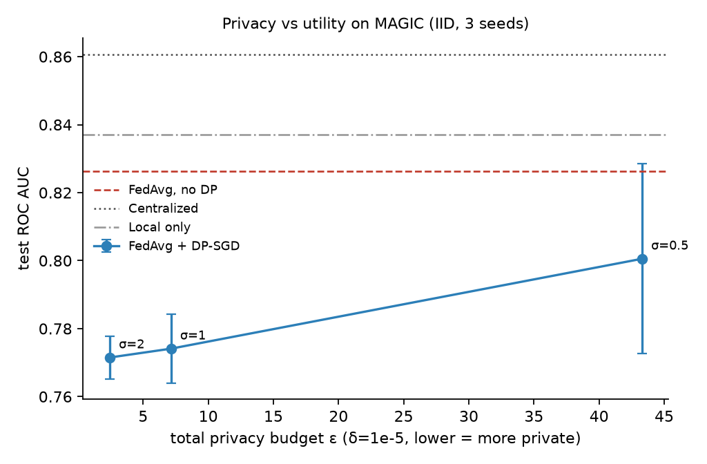
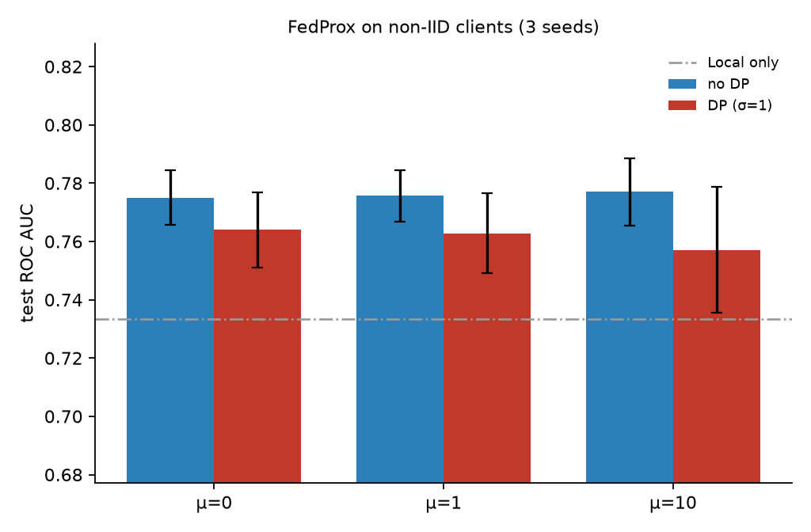

# Federated Anomaly Detection with Differential Privacy

A small, reproducible study of federated anomaly detection with client-side differential privacy (DP-SGD). Three simulated institutions train a variational autoencoder (VAE) on normal data only. The study compares federated training against centralized and local-only baselines, measures what DP costs in accuracy, and checks whether FedProx helps on non-IID clients.

Built with PyTorch and Opacus. Federated averaging is a custom simulation loop (no FL framework). Developed with [@Hiral373](https://github.com/Hiral373).

## Data

[MAGIC Gamma Telescope](https://www.openml.org/d/1120) (OpenML 1120): 19,020 real Cherenkov-telescope events, 10 features. Gamma showers are treated as "normal" (12,332) and hadron showers as the "anomaly" (6,688, **35% of the data**). This is a binary-separation benchmark for an anomaly detector, not a rare-event search.

- Stratified 60/20/20 train/validation/test split. The scaler is fit on normal training data only.
- Clients train on normal samples only. The validation set (normal and anomalous) selects the best round and the decision threshold. The test set is scored once.
- Anomaly score: reconstruction error from the VAE's latent mean (deterministic).

## Method

- **FedAvg:** sample-count-weighted averaging; 3 clients, 20 rounds, 2 local epochs per round.
- **DP-SGD:** Opacus, per-sample clipping (max norm 1.0) plus Gaussian noise, RDP accountant. Each client keeps one accountant for the whole run, so ε is cumulative across rounds (δ = 1e-5, worst-case client, sample-level DP).
- **FedProx:** applied as a proximal pull toward the global weights after each optimizer step. Adding the term to the loss does nothing under Opacus (see [Notes](#notes-on-fedprox-and-dp)).
- **Partitions:** `iid` (random split) and `noniid` (feature skew: samples ordered along the first principal component and cut into contiguous slices).
- **Baselines (same total training budget):** centralized (all normal data pooled) and local-only (each client alone, averaged).

## Results

3 seeds, mean ± std. Each seed changes the split, the partition and the initialisation. Full table: [results/RESULTS.md](results/RESULTS.md); raw runs: [results/results.csv](results/results.csv).

| Partition | Method | ROC AUC | AUPRC | F1 | ε |
|---|---|---|---|---|---|
| none | centralized | 0.861 ± 0.007 | 0.811 ± 0.008 | 0.721 ± 0.014 | – |
| iid | local-only | 0.837 ± 0.006 | 0.782 ± 0.007 | 0.686 ± 0.011 | – |
| iid | fedavg | 0.826 ± 0.013 | 0.769 ± 0.013 | 0.675 ± 0.015 | – |
| iid | fedavg+dp σ=0.5 | 0.801 ± 0.028 | 0.739 ± 0.023 | 0.645 ± 0.025 | 43.29 |
| iid | fedavg+dp σ=1.0 | 0.774 ± 0.010 | 0.716 ± 0.005 | 0.612 ± 0.001 | 7.13 |
| iid | fedavg+dp σ=2.0 | 0.771 ± 0.006 | 0.713 ± 0.004 | 0.613 ± 0.001 | 2.43 |
| noniid | fedavg (μ=0) | 0.775 ± 0.009 | 0.695 ± 0.017 | 0.614 ± 0.013 | – |
| noniid | local-only | 0.733 ± 0.003 | 0.651 ± 0.015 | 0.560 ± 0.006 | – |

<p align="center">
  
  
</p>

### What the numbers show

1. **On IID data, federation did not beat training locally.** Centralized is best (0.861); local-only (0.837) and FedAvg (0.826) are close, and their gap is within about one seed standard deviation. Each client already holds enough IID data on its own.
2. **On non-IID data, federation helps.** FedAvg reaches 0.775 against 0.733 for local-only, because a local model only sees one slice of the normal distribution.
3. **DP costs about 0.05 AUC at these budgets.** Moving from no DP (0.826) to σ=1 (ε≈7.1) gives 0.774, and σ=2 (ε≈2.4) gives 0.771, so the extra privacy from 7.1 to 2.4 cost little here. σ=0.5 (ε≈43) is noisy (±0.028) and a weak guarantee.
4. **FedProx made no measurable difference** at μ ∈ {0, 1, 10}, with or without DP. Differences between μ values are within seed noise (see the right chart and full table).

## Notes on FedProx and DP

A common implementation adds `(μ/2)·‖w − w_global‖²` to the loss. Under DP-SGD this term is silently discarded: Opacus rebuilds each update from per-sample gradients captured at the layers, so a term that depends only on parameters never reaches the update. [`checks/fedprox_under_dp.py`](checks/fedprox_under_dp.py) shows it: weights with μ=0 and μ=1 are identical with DP and differ without it. This repo applies the proximal pull after the optimizer step instead. It uses only the public global weights, so it is post-processing and costs no privacy budget.

## Limitations

- 3 seeds and 3 clients; standard deviations are rough.
- The model is a small VAE and the data is low-dimensional tabular; results may not carry over to larger models.
- MAGIC has 35% anomalies, unlike real rare-event settings.
- DP is sample-level per client, not user-level. ε is reported for the final round count only.
- Round selection and the threshold use a labelled validation set. A real unsupervised deployment may not have one, and this selection is not included in ε.
- No secure aggregation; the server sees plaintext client updates.
- One non-IID scheme (principal-component slices).

## Reproduce

```bash
pip install -r requirements.txt
python -m pytest tests                  # unit tests
python checks/fedprox_under_dp.py       # FedProx under DP-SGD check
python run_pipeline.py                  # one federated + DP run (quick demo)
python run_experiments.py               # full study (about an hour on CPU)
```

To run seeds in parallel, give each process its own file and merge afterwards:

```bash
SEEDS=0 OUT=results/results.csv     SKIP_SUMMARY=1 python run_experiments.py &
SEEDS=1 OUT=results/results_s1.csv  SKIP_SUMMARY=1 python run_experiments.py &
python summarize_results.py
```

## Layout

```
src/data.py        MAGIC loading, splits, IID / non-IID partitions
src/model.py       VAE, training loop (FedProx pull), scoring and evaluation
src/client.py      federated client with persistent DP accountant
src/server.py      FedAvg loop
src/baselines.py   centralized and local-only baselines
run_experiments.py full study; summarize_results.py merges runs
checks/            FedProx-under-DP-SGD check
tests/             unit tests
results/           CSV, table and charts
```
